
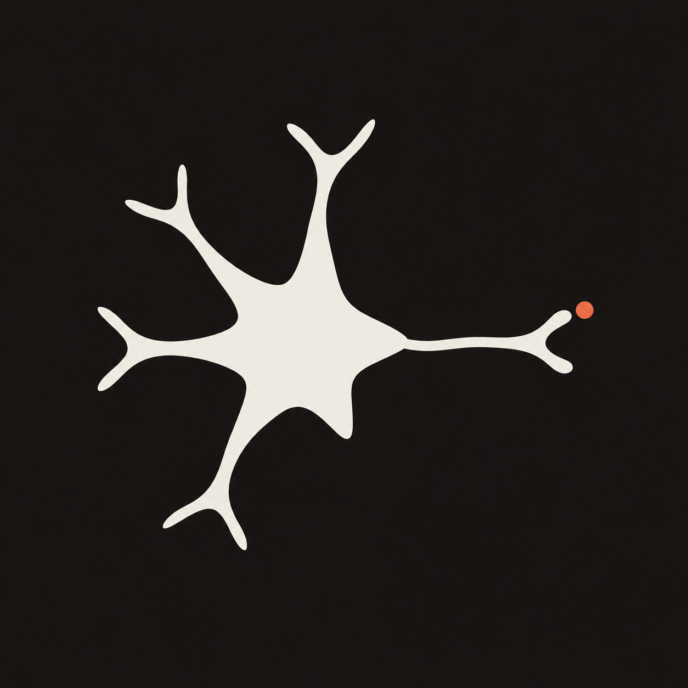

<h1 align="center">Simulaxon</h1>

<b>Prototype neural experiments in hours</b> 
AI agents test cognitive hypotheses by predicting fMRI responses to scenes they render in virtual worlds.

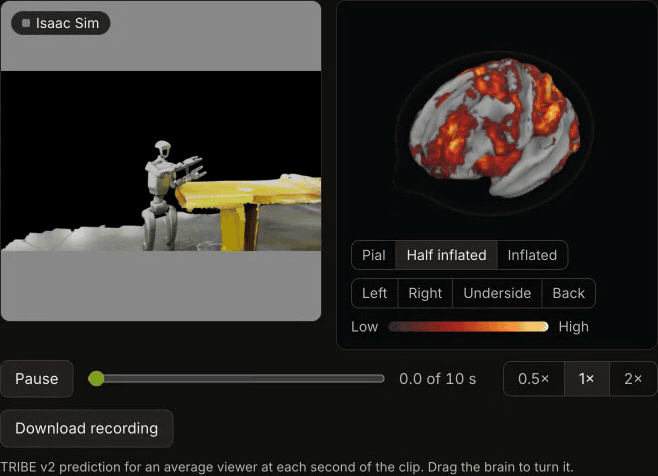

## The problem

How does the brain make sense of an event as it unfolds? To find out what drives a response, researchers need to vary what people see, hear, or know going into a scene. Testing those comparisons with people gets expensive fast, at tens of thousands of dollars per study.

Simulaxon gives researchers a way to develop the experiment before they bring in participants. The agent decides what to vary and what to hold fixed, generates the clips, and compares the predicted brain responses. It can then run a follow-up to see whether a pattern persists when another detail changes.

The predictions come from Meta's TRIBE v2, which trained on fMRI recordings of people watching films, television, and short videos of everyday events. In separate evaluations, it recovered known patterns of brain activity for seeing faces versus places and hearing descriptions of emotional versus physical pain.

## The loop

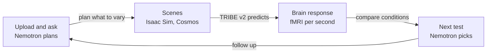

Isaac Sim renders a reference video of each trial, and Cosmos 3 Nano restyles it into realistic footage:

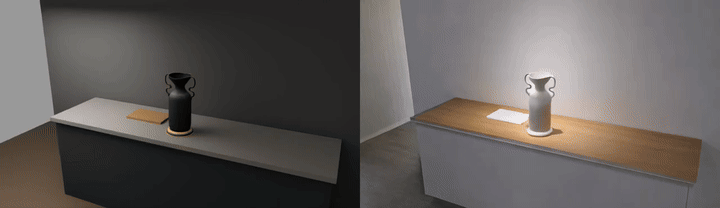

## Five steps in the app

**1. Ask the agent to design an experiment around your hypothesis.**

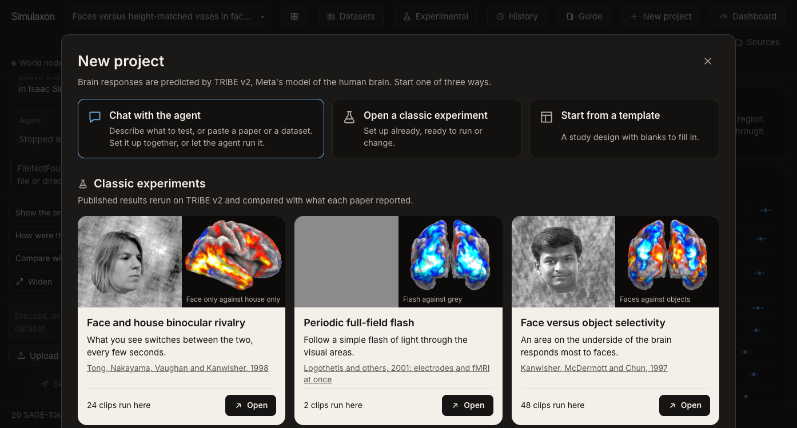

**2. Upload footage or describe the scenes you want to test.**

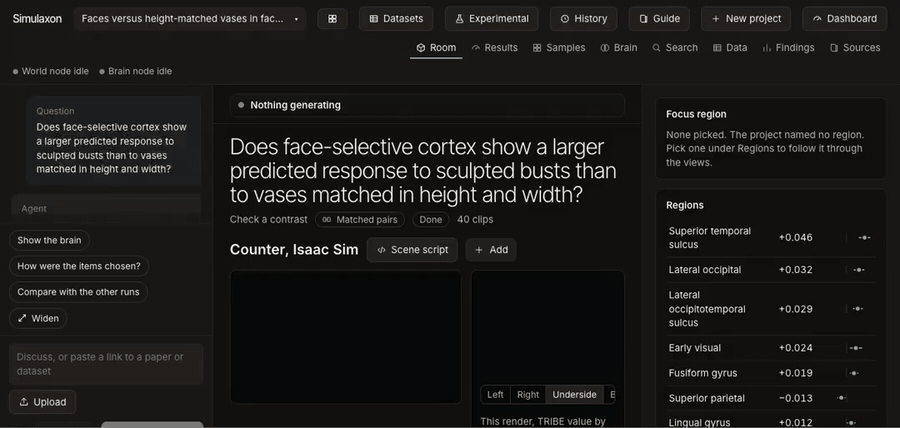

**3. Review the generated scenes and predicted responses alongside the agent's follow-up experiments.**

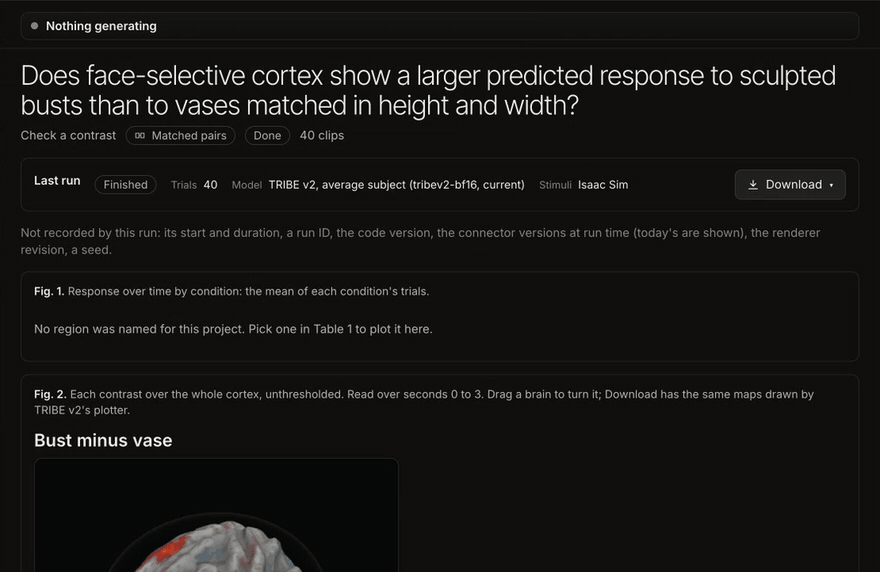

**4. Fit the model to measured fMRI.** If you have fMRI recordings you want to extrapolate from, one click fits an adapter that customizes the simulation results to those people.

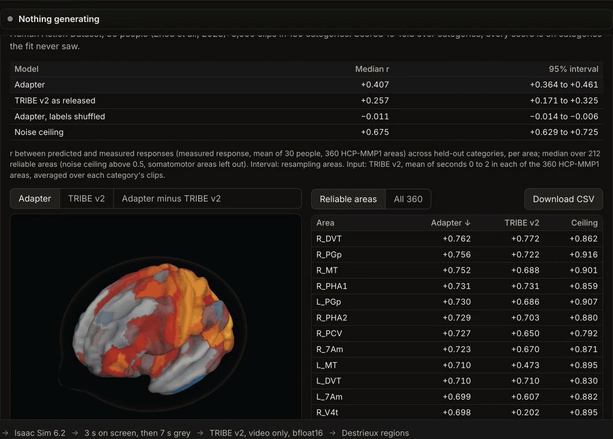

**5. Run robotics experiments** that use predicted human brain responses to test whether a robot can better anticipate what someone is about to do from the way they move.

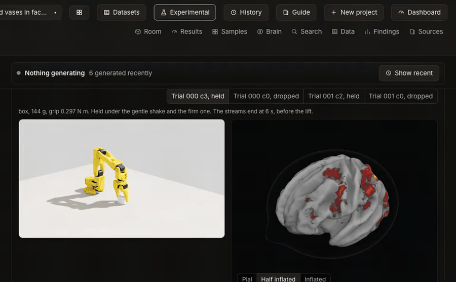

## Benchmark: the adapter on held-out actions

In one click, the adapter raises TRIBE v2's correlation with measured fMRI by 58%, on action categories it never trained on.

| | |
|---|---|
| **Data** | Human Action Dataset (OpenNeuro ds004488): fMRI of 30 people watching video clips of actions |
| **Fit** | Ridge regression in each of 360 HCP-MMP1 brain areas, from TRIBE v2's prediction to the measured response; 10 folds over action categories |
| **Scored on** | Held-out categories only, median r over 212 reliable areas |

| Predictions from | Median r | Share of the noise ceiling (0.675) |
|---|---|---|
| TRIBE v2 as released | 0.257 | 38% |
| **TRIBE v2 with the adapter** | **0.407** (95% interval 0.364 to 0.461) | **60%** |
| Same fit on shuffled labels | −0.011 | 0% |

The adapter scores higher than TRIBE v2 as released in 179 of the 212 areas.

## How it runs on CIQ

The app and the video pipeline together need an estimated 150 GB of memory, so Fuzzball starts them on separate 128 GB workstations and gives both access to the same VAST storage. When you submit a hypothesis, Nemotron Super 120B plans the experiment on the first workstation. The app sends the scene specifications to the second, where Isaac Sim renders a reference video, NVIDIA Cosmos 3 Nano uses it to generate realistic footage, and TRIBE v2 predicts the fMRI response to each clip.

The app sends the predictions back to Nemotron to compare conditions. If the agent chooses a follow-up, the app submits it to Fuzzball. Each round adds its clips, predictions, and log to the same VAST volume, so you can trace each result back to what the agent changed.

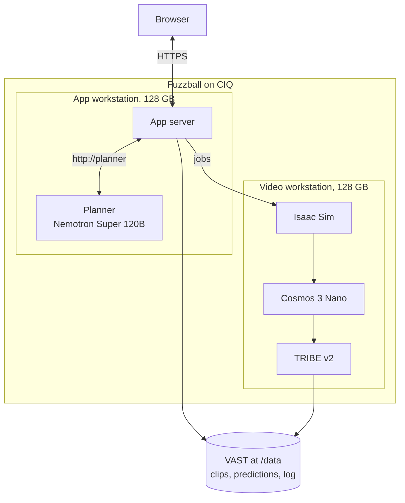

The full architecture, with memory per service

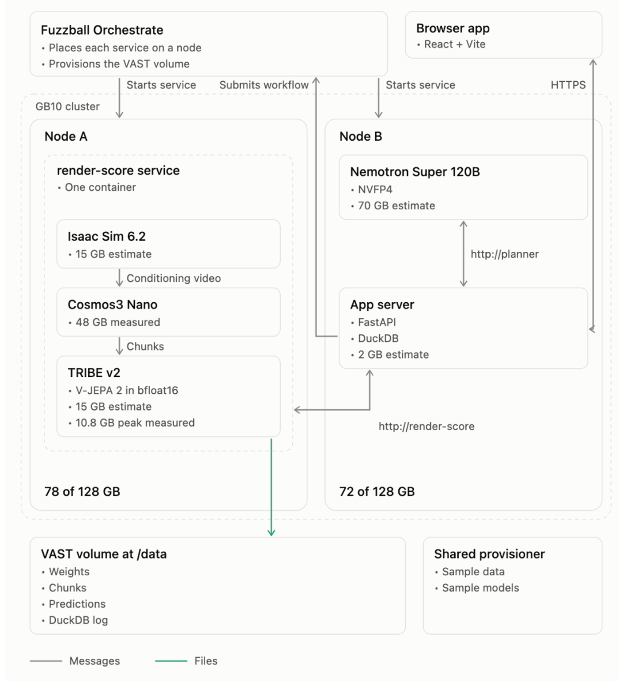

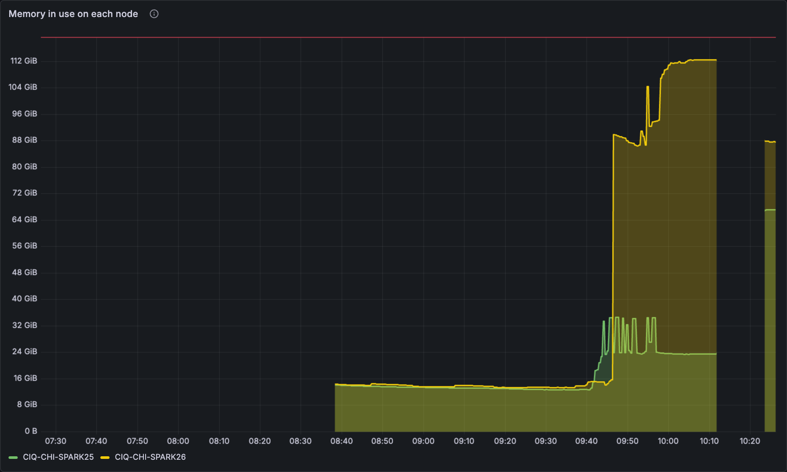

## Third-party code and licences

| Component | Source | Pinned at | Licence |
|---|---|---|---|
| TRIBE v2 | `github.com/facebookresearch/tribev2` | `af58661` | CC BY-NC 4.0 |
| Cosmos framework (Cosmos3-Nano-Sim-Transfer) | `github.com/NVIDIA/cosmos-framework` | `c3a2e37` | NVIDIA's terms |
| Isaac Sim 6.2 | NVIDIA | 6.2 | NVIDIA's licence |
| EgoBody, SMPL-X | Their owners, after registration | | Each dataset's own terms; never committed |

Working on the code: [docs/repository.md](docs/repository.md).
